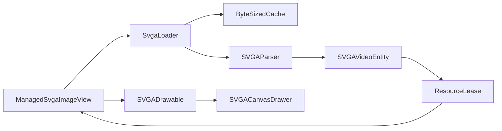

# 架构与所有权

## 加载和播放



请求由来源和目标宽高组成。文件来源的缓存身份还包含 canonical path、文件长度和修改时间。相同请求 key 共享一次正在进行的解码，完成后各个订阅者拿到独立 lease；不同采样尺寸使用不同实体缓存 key。

View 的 bind/清理和回调交付运行在主线程。decode 可以在播放器工作线程进行；音频准备完成后才将实体交付给缓存和客户端。错误不会作为可复用实体进入缓存。

## 为什么缓存淘汰不直接 clear

假设缓存和两个 View 共同拥有一个实体：

```text
缓存 owner + View A lease + View B lease = 3 个引用
清缓存后                                 = 2 个引用，仍可播放
View A 离开                              = 1 个引用，View B 仍可播放
View B 离开                              = 0 个引用，清实体
```

缓存只管理自己的 owner lease。资源被缓存替换、清理或淘汰时释放缓存所有权，不触碰 client lease。超过缓存预算的大资源仍可返回给请求方，但不继续留在缓存中。

`ResourceLease.close` 幂等。`fork` 创建新所有者；`value` 不能在本 lease 已关闭后读取。关闭最后一个 lease 后在锁外执行资源清理，避免清理回调导致锁反转。

## 请求和 View 生命周期

重新 bind 会使旧代次失效。即便旧解码随后成功，旧结果也不能安装到新 View；其 lease 会被关闭。

取消存在两种情况：尚未交付的结果由 loader 负责释放；已经交付的 lease 则仍属于调用方。网络下载取消是尽力而为，本地解析已经开始时可能继续完成。正确性依赖结果归属和释放，不能依赖任务一定即时终止。

View detach、临时 detach 或不可见时立即取消未交付请求；已显示资源排队到主线程清理，恢复资格可撤销清理并保留原 Drawable 和播放状态。若清理已执行，再恢复时重新加载。显式清除或换绑始终立即释放。Loader 注册 ComponentCallbacks2 以响应内存通知，关闭后注销并拒绝新请求。

## 共享与非共享状态

- 可共享：解码图片、帧数据、音频 sample 数据及实体的准备结果。
- 每个 View/Drawable 独立：播放代次、ValueAnimator、当前帧、动态内容对象、音频 stream ID。
- 属于 loader：内存缓存、in-flight 请求和未交付结果。

帧数据和位图虽然由同一个实体承载，直接 player API 仍暴露部分可变属性。通过 runtime 接入时，不应在外部调用实体 clear 或修改共享图片/帧内容。不同 View 的动态图片和文本应使用各自的 SVGADynamicEntity。

## 预算和并发限制

`cachedBytes` 只统计当前缓存持有的估算资源大小。正在播放但已被淘汰的实体不在此数中，仍会占用实际内存。估算包括已解码位图及保留的 encoded image 数据，不包括完整对象图、GPU、native 声音内存。

默认工作线程数有界，任务排队不代表总待处理请求有硬上限。大型或大量不同动画仍需业务层节制请求，并在真实设备上测量。首版没有引入帧转置、激进位图降质或音频格式裁剪。
